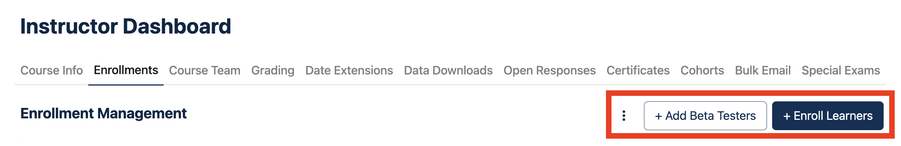
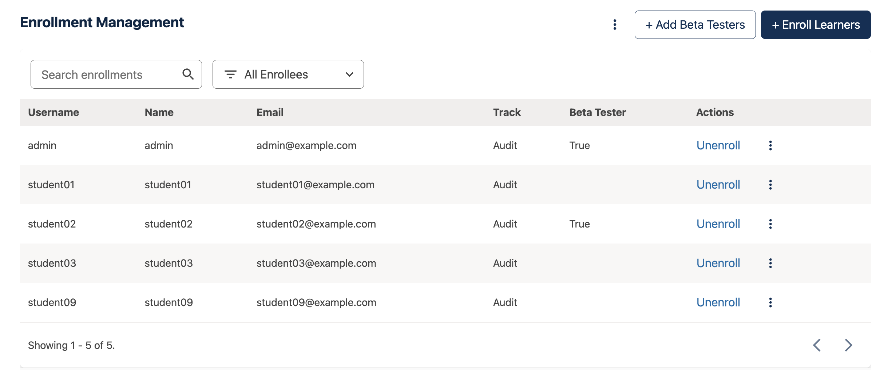
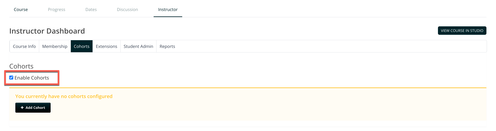
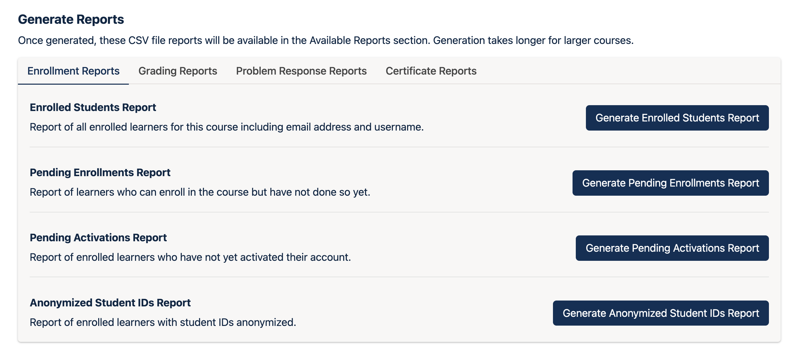

# How to Manage Enrollments on the Open edX® platform

This guide is for platform administrators and course teams. It explains how to enroll and unenroll learners, organize them in cohorts and download enrollment reports.

**You will need:**

- The **Staff** or **Admin** role in the course, or Staff status on the platform
- For downloading reports: the **Course Data Researcher** role, or Staff or Admin

> **Note:** The steps describe the new Instructor Dashboard in the Verawood release of the Open edX® platform. In older releases, the **Enrollments** and **Course Team** pages are combined in one page called **Membership**, and **Data Downloads** is called **Data Download**.

---

## Part 1: Enroll Learners in a Course

1. **Open the Instructor Dashboard:**
   Open the course in the LMS (for example, select **View live** in Studio), then select the **Instructor** tab.

2. **Go to Enrollments:**
   Select **Enrollments**. The **Enrollment Management** page lists everyone enrolled in the course.

3. **Start the enrollment:**
   Select **+ Enroll Learners** in the top-right corner.

   

4. **Enter the learners:**
   Enter the email addresses or usernames, separated by commas or new lines. You can copy and paste a column of email addresses from a spreadsheet.

5. **Choose the options:**
   - Leave **Auto Enroll** selected. Learners who don't have an account yet are enrolled automatically as soon as they register with that email address.
   - Leave **Notify Users by Email** selected to send learners an email.

6. **Save:**
   Select **Save**. A message shows who was enrolled, who will be enrolled once they register and which entries weren't found.

> Learners are enrolled even if the course's enrollment start date hasn't passed yet. They are enrolled in the **Audit** track by default.

> **Tip:** This method works best for small and medium-sized groups. For very large groups, contact Abstract-Technology.

---

## Part 2: Find, Check and Unenroll Learners

1. **Find a learner:**
   On the **Enrollments** page, use **Search enrollments** or the **All Enrollees** filter to find a learner. The table shows each learner's username, name, email, enrollment track and beta tester status.

   

2. **Check a learner's status:**
   Open the **⋮** menu next to **+ Add Beta Testers** and select **Check Enrollment Status**. Enter the email address or username.

3. **Unenroll one learner:**
   Select **Unenroll** in the learner's row and confirm.

4. **Unenroll several learners at once:**
   Open the **⋮** menu, select **Unenroll Learners**, enter the email addresses or usernames and confirm.

> **Good to know:**
> - Unenrolling doesn't delete a learner's data. If they enroll again, their progress is restored.
> - To stop learners from enrolling again, also set the **Enrollment End Date** in Studio (**Settings** > **Schedule & Details**) to a date in the past.

---

## Part 3: Organize Learners in Cohorts

Cohorts divide learners into groups, for example by region, organization or learning track. You can use them to run group-specific discussions or to show different content to different groups.

1. **Enable cohorts:**
   In the Instructor Dashboard, select **Cohorts**, then select **Enable Cohorts**.

   

2. **Add a cohort:**
   Select **Add Cohort** and enter a **Cohort Name**. Learners can see the name of their cohort.

3. **Choose how learners are assigned:**
   Under **Cohort Assignment Method**, choose one:
   - **Automatic:** learners are assigned to cohorts automatically.
   - **Manual:** learners are added only when you enter them yourself.

4. **Link a content group (optional):**
   Under **Associated Content Group**, choose a content group to show this cohort specific course content. Content groups are created in Studio under **Settings** > **Group Configurations**.

5. **Save:**
   Select **Save**.

6. **Add learners to a cohort manually:**
   Choose the cohort in **Select a cohort** and open the **Manage Learners** tab. Under **Add Learners to this cohort**, enter email addresses or usernames, separated by commas or new lines, then select **Add Learners**.

7. **Assign many learners with a CSV file:**
   Use **Assign learners to cohorts by uploading a CSV file**. The file needs a header row with an **email** or **username** column, or both, and a **cohort** column. Save it with UTF-8 encoding; the maximum size is 2 MB.

> **Note:** A learner can be in only one cohort. Adding a learner to a cohort replaces their previous assignment. Set up your cohorts before the course starts so learners don't change groups while the course is running.

---

## Part 4: Download Enrollment Reports

1. **Open Data Downloads:**
   In the Instructor Dashboard, select **Data Downloads**.

2. **Choose an enrollment report:**
   Under **Generate Reports**, open the **Enrollment Reports** tab and select the report you need:
   - **Enrolled Students Report:** all enrolled learners, with email address and username.
   - **Pending Enrollments Report:** learners who can enroll but haven't done so yet.
   - **Pending Activations Report:** enrolled learners who haven't activated their account yet.
   - **Anonymized Student IDs Report:** enrolled learners with anonymized IDs.

   

3. **Wait for the report:**
   Generating a report can take a few minutes for large courses. You can leave the page and come back later.

4. **Download the file:**
   The finished report appears under **Available Reports**. Select it to download the CSV file.

> **Data protection:** These reports contain personal data. Download links expire after 5 minutes, and report files are deleted 90 days after they're generated. Store downloaded files according to your organization's data protection rules.

> **Tip:** For a quick count of enrollments, open **Course Info** in the Instructor Dashboard. It shows the number of enrollments in total, for staff and for learners, and per enrollment track.

---

*Need help? If a learner doesn't appear after enrollment, check the **Pending Enrollments Report**. They may not have registered yet, or they may have registered with a different email address.*

---

*Screenshots: [Open edX documentation](https://docs.openedx.org/en/latest/educators/index.html), licensed under [CC BY-SA 4.0](https://creativecommons.org/licenses/by-sa/4.0/).*
