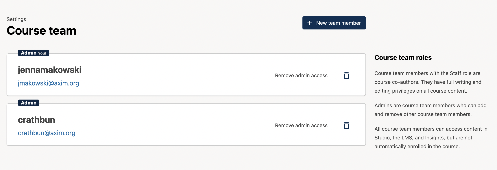
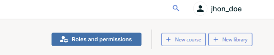
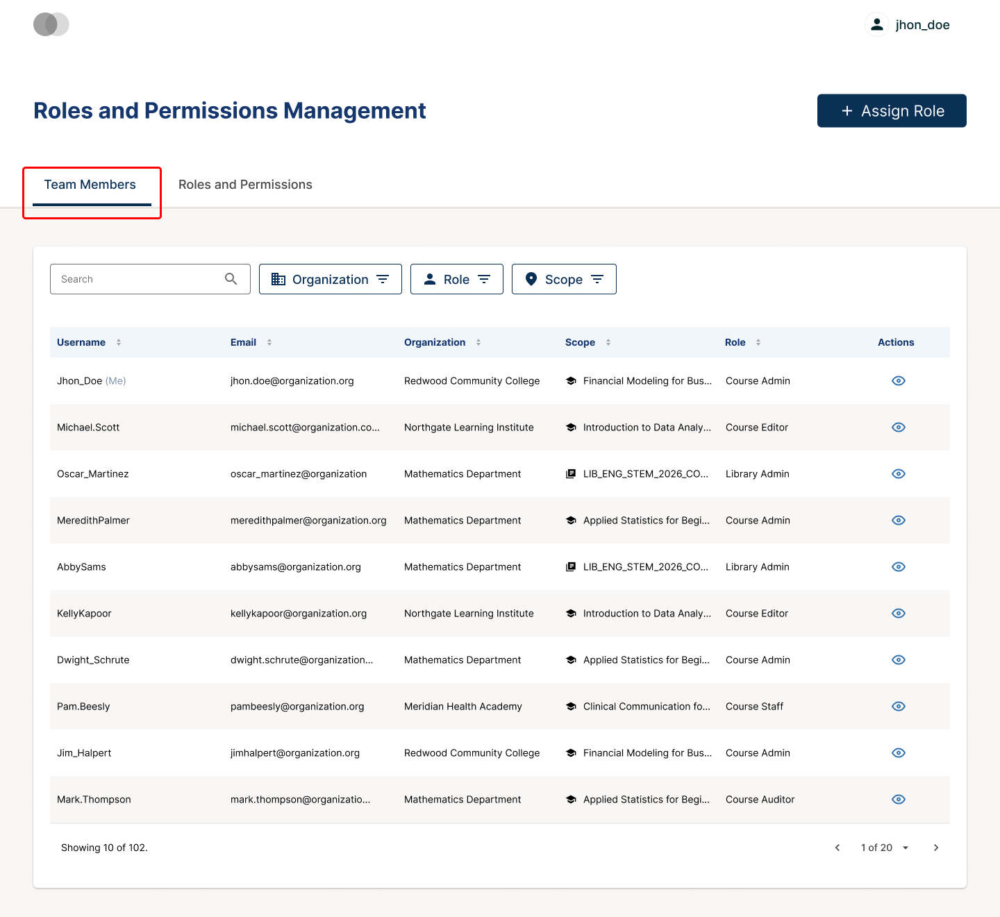
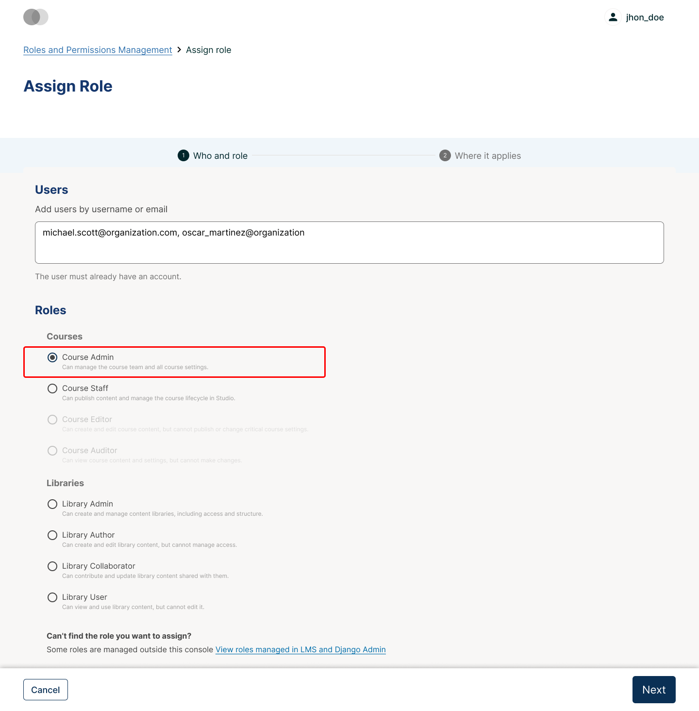

# How to Manage Users on the Open edX® platform

This guide is for platform administrators. It explains how to create user accounts, give users the right roles, deactivate accounts and bring in many users at once.

**You will need:**

- An account with **Staff** or **Superuser** status on the platform, to use the Django administration panel
- The **Admin** role in a course, to manage that course's team

> **Note:** The steps describe the Verawood release of the Open edX® platform. In older releases some menu names in the Instructor Dashboard are different. These differences are noted where they matter.

---

## Part 1: Create a User Account

Learners usually create their own accounts with **Sign Up** on the platform's home page. As an administrator, you can also create an account yourself in the Django administration panel.

1. **Open the Django administration panel:**
   Go to `https://<your-lms-domain>/admin/` and sign in with your administrator account.

2. **Open the user list:**
   Under **Authentication and Authorization**, select **Users**.

3. **Add a new user:**
   Select **Add user** in the top-right corner. Enter a **Username** and the **Password** twice, then select **Save and continue editing**.

   > The username can't be changed after the account is saved, so check it before you save.

4. **Complete the account details:**
   - Enter the **Email address**, and the **First name** and **Last name** if you want.
   - In the **User profile** section at the bottom, enter the user's full **Name**. This name appears on certificates.
   - Make sure **Active** is selected. An active account can sign in without first confirming its email address.

5. **Save:**
   Select **Save**. The user can now sign in with the username or email address and the password you set.

> **Tip:** Leave **Staff status** and **Superuser status** cleared for normal users. These options give access to the whole platform and its administration panel.

---

## Part 2: Give Users a Role

Each kind of access is set in a different place, depending on what the user should be allowed to do.

### Allow a user to create courses in Studio

When course creation is restricted on your platform, authors request access from the Studio home page, and an administrator grants it.

1. Go to the **Studio** Django administration panel at `https://<your-studio-domain>/admin/course_creators/coursecreator/`. This page exists only in the Studio (CMS) administration panel. You won't find it in the LMS administration panel.
2. Select the user.
3. Set **State** to **granted**. You can also limit access to specific organizations.
4. Select **Save**.

### Add a member to a course team in Studio

1. In Studio, open the course and select **Settings** > **Course Team**.
2. Select **New team member**.
3. Enter the user's email address and select **Add user**.
4. To let this person manage the team too, select **Add admin access** next to their name.

   

> The user must already have an activated account.

### Assign a role from the Instructor Dashboard

The Instructor Dashboard offers more roles, such as **Limited Staff**, **Beta Testers**, **Course Data Researchers** and the discussion moderation roles.

1. Open the course in the LMS and select the **Instructor** tab.
2. Select **Course Team**. In older releases, this is **Membership** > **Course Team Management**.
3. Select **Add Team Member**.
4. Enter one or more usernames or email addresses, choose a **Role** and select **Save**.

To change or remove a role, select **Edit** in the user's row in the team list.

### Use the Roles and Permissions console (if enabled)

On platforms where the **Roles and Permissions** console is enabled, you can manage team roles for all your courses and libraries in one place.

1. On the Studio home page, select **Roles and permissions** in the top-right corner. The console opens in a new tab.

   

2. On the **Team Members** tab, you can see each user's role assignments. Use the search bar and the **Organization**, **Role** and **Scope** filters to find a user.

   

3. To give someone a role, select **Assign Role**. In **Who and role**, enter one or more usernames or email addresses and choose the role.

   

4. Select **Next**. In **Where it applies**, choose the courses or libraries, then select **Save**.

> This console is not enabled by default. Ask Abstract-Technology if you want to use it on your platform.

---

## Part 3: Deactivate a User Account

Deactivate an account to stop someone from signing in while keeping their data and course history.

1. In the LMS Django administration panel, go to **Users** and search for the username or email address.
2. Open the user's record.
3. Clear the **Active** checkbox.
4. Select **Save**.

The user can no longer sign in. To give access back, select **Active** again and save.

> **Before you deactivate a course team member:** remove their course team roles as well (see Part 2), so the access list stays accurate.

> **Deleting an account:** to remove a user's personal data permanently, for example after a GDPR request, the account must be *retired*, which is different from deactivating it. Retirement is a platform-level process. Contact Abstract-Technology to have an account retired.

---

## Part 4: Bring In Many Users at Once

The Open edX® platform has no general bulk import of user accounts in the administration panel. You can use one of these options instead.

### Option A: Enroll by email, and learners register themselves

Enter a list of email addresses in the course's **Enrollments** page with **Auto Enroll** selected (see the *Manage Enrollments* guide). Learners who don't have an account yet are enrolled automatically once they register with that email address.

### Option B: Upload a CSV file that creates accounts (if enabled)

Some platforms have a **Register/Enroll Students** section in the Instructor Dashboard, under **Membership**. It creates accounts and enrolls them in the course from a CSV file.

1. Prepare a CSV file with these columns, in this order: **email, username, name, country**. Add one user per row, without a header row or blank lines. You can add two optional columns, **cohort** and **course mode**.
2. In the Instructor Dashboard, select **Membership** and find **Register/Enroll Students**.
3. Select **Browse**, choose the file and select **Upload CSV**. To email the new users, select **Notify users by email** first.

> This section only appears when the platform setting `ALLOW_AUTOMATED_SIGNUPS` is enabled. It is part of the legacy Instructor Dashboard and isn't available in the new Verawood Instructor Dashboard.

### Option C: Ask Abstract-Technology

For large imports, or to connect your organization's login (single sign-on), contact Abstract-Technology. We can import accounts at platform level or set up single sign-on, so users sign in with their existing organization account.

---

*Need help? If a user can't sign in or doesn't appear in a search, check that the account is **Active** and that you are searching by the correct username or email address. For anything else, contact the Abstract-Technology support team.*

---

*Screenshots: [Open edX documentation](https://docs.openedx.org/en/latest/educators/index.html), licensed under [CC BY-SA 4.0](https://creativecommons.org/licenses/by-sa/4.0/).*
