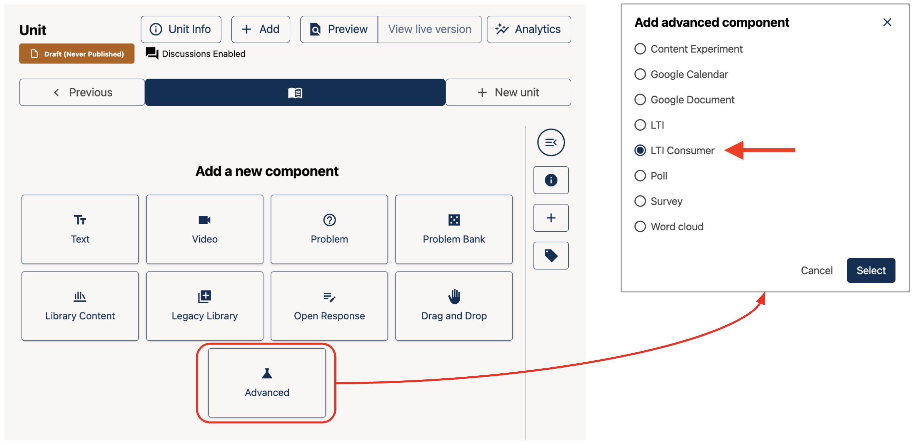
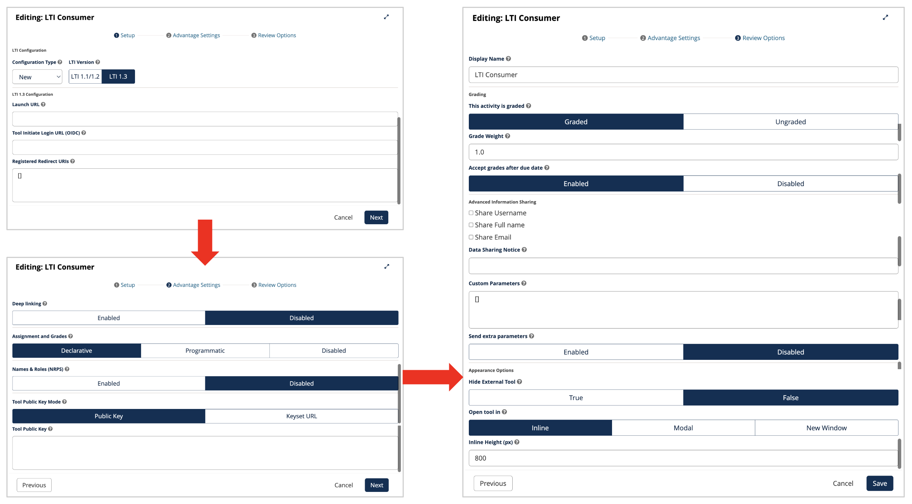

# How to Manage Platform Settings on the Open edX® platform

This guide is for platform administrators. It explains which settings you can change yourself for branding, languages and integrations, and which ones Abstract-Technology sets up for you.

**You will need:**

- An account with **Staff** or **Superuser** status, to use the Django administration panel at `https://<your-lms-domain>/admin/`
- For course-level settings: the **Admin** role in the course in Studio

> **Important:** Settings in the Django administration panel apply to the whole platform. A wrong value can affect every user. Write down the current value before you change anything, and contact Abstract-Technology if you are unsure.

---

## Part 1: Branding

### What Abstract-Technology sets up for you

The look of your platform comes from its **theme**: logo, colors, fonts, favicon, home page and footer. Themes are installed on the server, so you can't change them in the administration panel. To change your logo, colors or footer links, send the new files or details to Abstract-Technology.

### Change the platform name and contact emails

You can change the platform name and the email addresses used in messages to learners in the site configuration.

1. **Open the site configuration:**
   In the Django administration panel, go to **Site Configuration** > **Site configurations**.

2. **Open your site:**
   Select your site's existing configuration. If there is none, select **Add site configuration** and choose your site in the **Site** list.

3. **Edit the values:**
   The **Values** field contains the settings in JSON format. Change only the values you need, for example:

   ```json
   {
     "PLATFORM_NAME": "Your Learning Platform",
     "email_from_address": "learning@your-organization.org",
     "course_email_from_addr": "courses@your-organization.org"
   }
   ```

   Keep the JSON valid: quotes around names and text, commas between entries and no comma after the last entry.

4. **Enable and save:**
   Make sure **Enabled** is selected, then select **Save**. The settings have no effect until **Enabled** is selected.

> **Tip:** Copy the full content of the **Values** field into a text file before you edit it, so you can restore it if something goes wrong.

### Course-level branding

Course images, the course description and the About page are set for each course in Studio, under **Settings** > **Schedule & Details**.

---

## Part 2: Languages

There are three language settings, each for something different.

### Choose which languages learners can select

The language menu only shows the languages that have been released on your platform.

1. In the Django administration panel, go to **Dark_Lang** > **Dark lang configs**.
2. Select **Add dark lang config**.
3. In **Released languages**, enter the language codes separated by commas, for example `en, de, es, fr`.
4. Select **Enabled** and then **Save**.

> Each new entry replaces the previous one, so always enter the full list of languages, not only the new one. The platform's interface translations must be available for a language before learners can use it. Ask Abstract-Technology if you aren't sure which languages are installed.

### Learners choose their own language

Each learner can choose the platform language in **Account** settings, under **Site Preferences** > **Site language**, from the released languages.

### Set the language of a course

In Studio, open the course and select **Settings** > **Schedule & Details**. Choose the **Course language**. This describes the language the course is taught in. It doesn't translate the course content.

---

## Part 3: Integrations

### Add an external learning tool (LTI) to a course

With LTI, you can show external tools inside a course unit, for example an H5P activity, a virtual lab or video conferencing.

1. **Enable the LTI component for the course:**
   In Studio, select **Settings** > **Advanced Settings**. In **Advanced Module List**, add `"lti_consumer"`. If the list already has other entries, separate them with commas, for example `["lti_consumer", "drag-and-drop-v2"]`. Select **Save Changes**.

2. **Add the tool to a unit:**
   Open the unit, select **Advanced** under **Add a new component**, choose **LTI Consumer** and select **Select**.

   

3. **Configure the tool:**
   Select **Edit** on the new component. The settings are on three tabs: **Setup**, **Advantage Settings** and **Review Settings**. Enter the values from the tool provider, such as the LTI version, launch URL and keys.

   

4. **Publish and test:**
   Publish the unit, then open it in the LMS and launch the tool as a learner and as staff.

> **Tip:** Once an LTI component works, you can copy or duplicate it into other units and courses. The copy keeps working.

### Integrations set up by Abstract-Technology

These integrations are configured at platform level. Contact Abstract-Technology to add or change them:

- **Single sign-on (SSO):** sign in with your organization's account, for example Microsoft Entra ID, Google or Keycloak (SAML or OAuth2)
- **Analytics and tracking tools:** for example Google Analytics or Matomo
- **Email and newsletters:** for example the Mailchimp integration
- **Aspects analytics:** dashboards for reports (see the *Reports and Analytics* guide)
- **E-commerce and payments**
- **Platform features** controlled by feature flags, such as milestones, learning goals or the Roles and Permissions console

---

*Need help? If a change in the administration panel doesn't show up, wait a few minutes and reload the page. Some settings are cached. If it still doesn't appear, contact the Abstract-Technology support team.*

---

*Screenshots: [Open edX documentation](https://docs.openedx.org/en/latest/educators/index.html), licensed under [CC BY-SA 4.0](https://creativecommons.org/licenses/by-sa/4.0/).*
