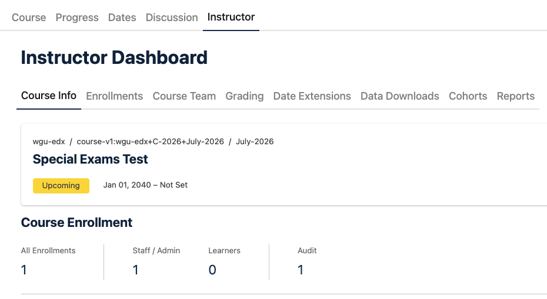
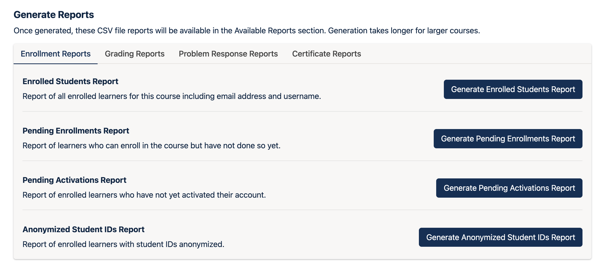
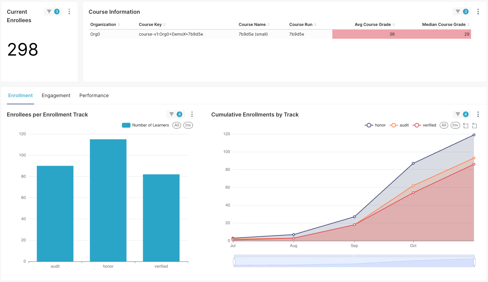
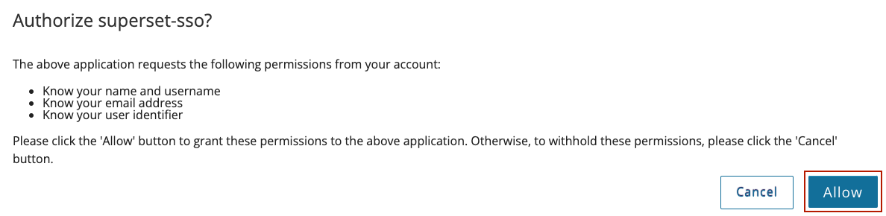
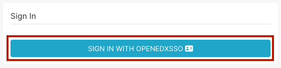
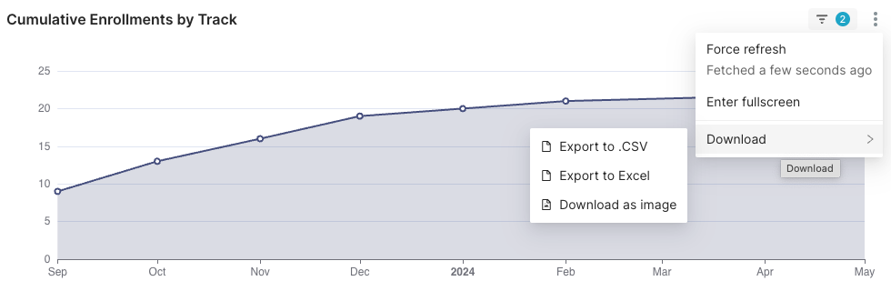
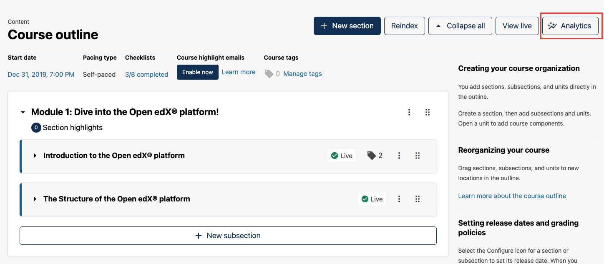
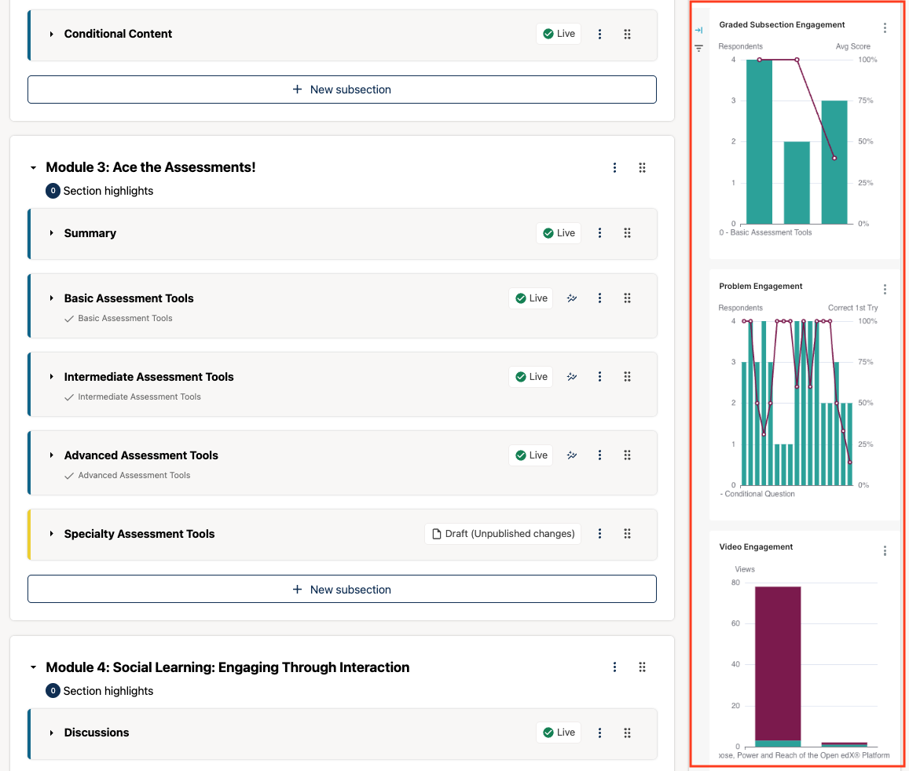

# How to Use Reports and Analytics on the Open edX® platform

This guide is for platform administrators and course teams. It describes the dashboards available on the Open edX® platform and how to export their data.

There are three places to find data:

| Tool | Where | Best for |
|---|---|---|
| **Instructor Dashboard** | LMS, **Instructor** tab of a course | Course facts, enrollment counts and downloadable CSV reports |
| **Aspects dashboards** | LMS **Reports** tab, and Superset | Interactive charts on enrollment, engagement and performance |
| **In-Context Analytics** | Studio course outline and unit pages | Engagement data next to the content you are editing |

> **Note:** Aspects and In-Context Analytics are only available if they are installed on your platform. Contact Abstract-Technology if you want them enabled.

**You will need:**

- The **Staff** or **Admin** role in the course
- For data downloads: the **Course Data Researcher** role, or Staff or Admin

---

## Part 1: Check Course Information at a Glance

1. Open the course in the LMS and select the **Instructor** tab.
2. Select **Course Info**. This page shows the course name and ID, its start and end dates, its status, and the number of enrollments in total, for staff and for learners, and per enrollment track.

   

---

## Part 2: Generate and Download CSV Reports

1. **Open Data Downloads:**
   In the Instructor Dashboard, select **Data Downloads**.

2. **Choose a report type:**
   Under **Generate Reports**, reports are grouped in tabs:
   - **Enrollment Reports:** enrolled learners, pending enrollments, pending activations and anonymized student IDs.
   - **Grading Reports:** the **Grade Report** with each learner's course grade, and the **Problem Grade Report** with each learner's grade for every problem.
   - **Problem Response Reports:** all learner answers to a problem, a section or the whole course, plus reports and file archives for open response assessments (ORA).
   - **Certificate Reports:** the certificates issued in the course.
   - **Proctored Exam Reports:** results of proctored exams, if the course uses them.

   

3. **Generate the report:**
   Select the **Generate …** button for the report you need. Large courses can take several minutes. You can leave the page and come back later.

4. **Download the file:**
   When the report is ready, it appears under **Available Reports**, with the date and time it was generated in UTC. Select it to download the CSV file. You can open it in Excel or another spreadsheet program.

> **Data protection:**
> - Reports contain personal data. Store them according to your organization's data protection rules.
> - Download links expire after 5 minutes. Don't copy them to share with others; download the file instead.
> - Report files are deleted 90 days after they're generated, so download any you want to keep.

> **Tip:** Generate a grade report as soon as certificates have been issued, so you keep a record of the final grades.

---

## Part 3: Open the Aspects Dashboards

Aspects gives you interactive dashboards with near real-time course data.

1. **Open Reports:**
   In the course's Instructor Dashboard, select the **Reports** tab.

2. **Choose a dashboard:**
   - **Course Dashboard:** enrollment, engagement and performance for all learners in the course.
   - **At-Risk Learners:** learners who haven't passed yet and haven't visited the course in seven days or more.
   - **Individual Learner:** activity of a single learner.

   

3. **Filter the data:**
   Use the filters on the dashboard, such as the time range or course, to narrow down the data. Selecting an item in a chart, for example a single video, filters the other charts too.

### Open Superset to compare courses

For dashboards across several courses or the whole platform, open Superset, the tool behind the Aspects dashboards.

1. Select the link to Superset from the **Reports** tab.
2. The first time, select **Allow** to let Superset use your platform account.

   

3. Select **Sign in with OpenedXSSO**. You are signed in with your platform account, without a separate password.

   

4. In Superset, select **Dashboards** and open the dashboard you need.

> Platform administrators can see every course in Superset. Course team members see the courses they work on.

---

## Part 4: Export Data from a Dashboard Chart

1. Hover over the chart or table you want to export and open its **⋮** menu in the top-right corner.
2. Select **Download**, then choose:
   - **Export to .CSV** or **Export to Excel** for the data behind the chart.
   - **Download as image** for a picture of the chart, for presentations or reports.

   

---

## Part 5: See Analytics in Studio (In-Context Analytics)

In-Context Analytics shows engagement data while you work on the course in Studio.

1. In Studio, open the **Course outline** and select **Analytics** at the top of the page.

   

2. A sidebar opens with charts for graded subsection, problem and video engagement.

   

3. To see more detail, select a subsection, problem or video below the charts. On a unit page, select a component to see the data for that component only.

> **Reading the data:** a low share of correct answers on the first attempt can mean that a problem is too difficult or unclear. Many repeat views of part of a video can mean that part needs to be explained better.

---

*Need help? If the **Reports** tab or the **Analytics** button is missing, Aspects or In-Context Analytics may not be enabled on your platform. Contact Abstract-Technology.*

---

*Screenshots: [Open edX documentation](https://docs.openedx.org/en/latest/educators/index.html), licensed under [CC BY-SA 4.0](https://creativecommons.org/licenses/by-sa/4.0/).*
