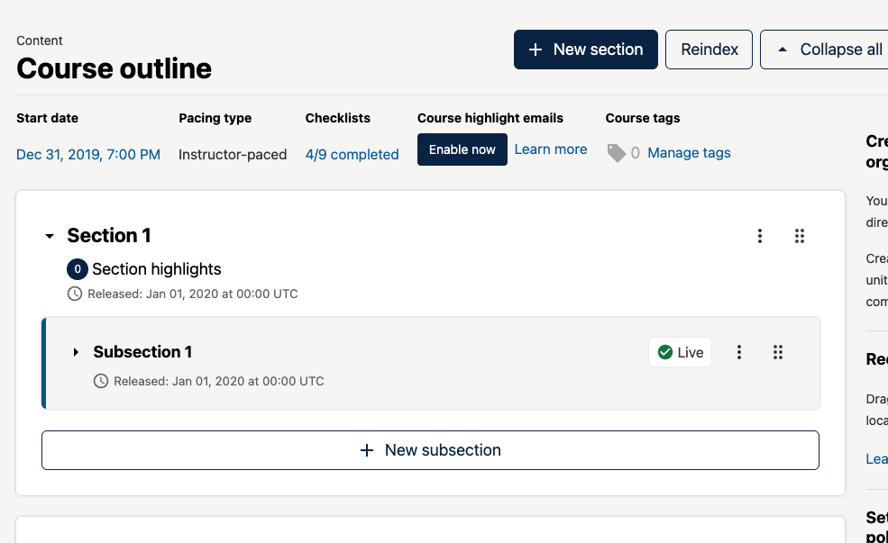
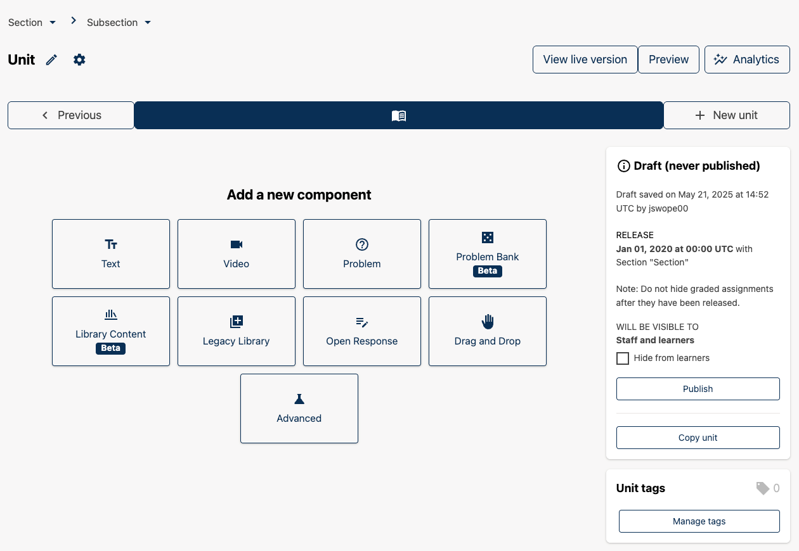
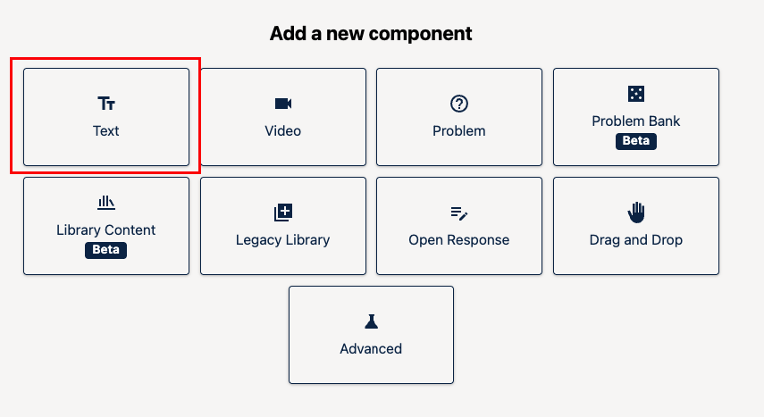
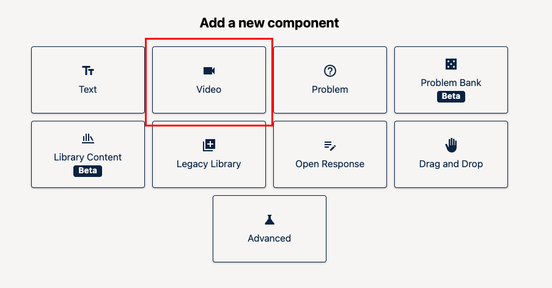
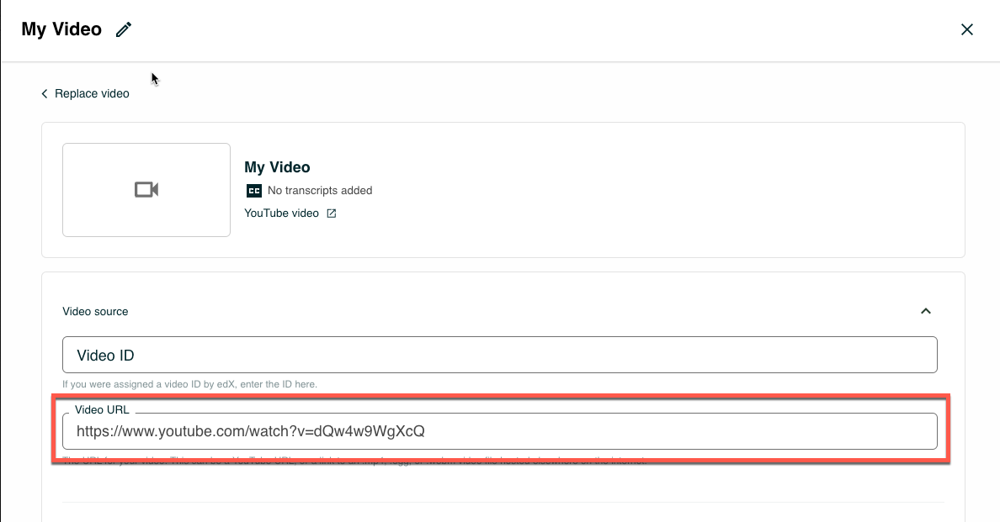
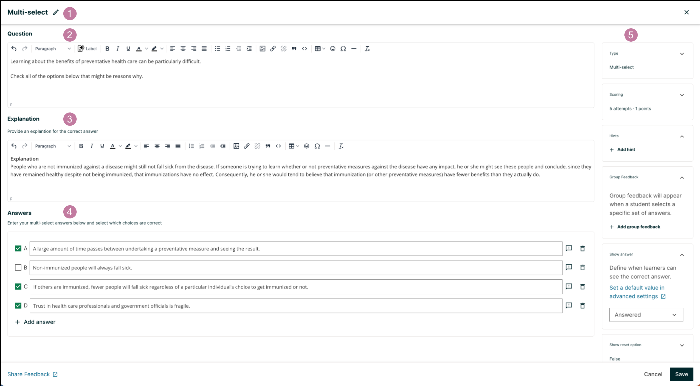
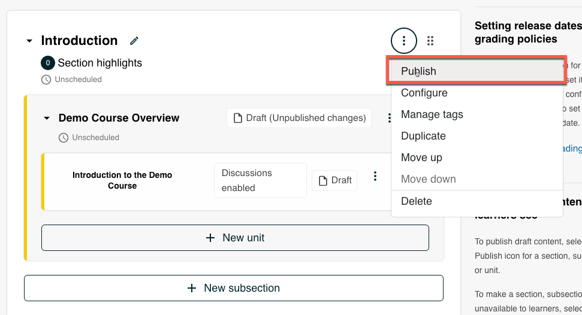

Structuring your course content effectively in Open edX Studio ensures a smooth and engaging learning experience. Following the architectural updates in the **Verawood release**, here is how to build your curriculum using sections, subsections, and units.

## Understanding the Course Hierarchy
Open edX uses a strict hierarchical structure:
* **Sections (Chapters):** Broad modules or weeks of your course.
* **Subsections (Sequentials):** Specific topics or sub-modules within a section.
* **Units (Verticals):** Individual pages containing the actual learning materials (videos, text, problems).
* **Components:** The building blocks inside a unit (HTML text, video players, quizzes, etc.).

---

## Part 1: Structuring Sections and Subsections

1. **Open Your Course in Studio:**
   * Log in to Studio and select your course to open the **Course Outline**.

2. **Add a Section (Chapter):**
   * Click the **"+ Add Section"** button at the bottom of the course outline.
   * Enter a clear title for your section (e.g., *Module 1: Introduction to Renewable Energy*) and press **Enter** or click **Save**.

     

3. **Add a Subsection (Sequential):**
   * Within your new section, click the **"+ Add Subsection"** button.
   * Enter a descriptive title (e.g., *1.1 Core Concepts*) and save.

---

## Part 2: Creating Units and Adding Components

1. **Add a Unit:**
   * Under your subsection, click the **"+ Add Unit"** button.
   * Name your unit (e.g., *Lecture: Energy Basics*) and click **Save**.

2. **Open the Unit Editor:**
   * Click on the newly created unit title to open the visual unit editor page.

     

3. **Add Components (Verawood Layout):**
   * You will see the component toolbar offering options to add content types: **Text**, **Video**, **Problem**, or **Advanced**.
   * Click on **Text** to add rich text, formatted headings, and images.

     

   * Click on **Video** to configure video lectures, upload subtitles, and set up the video player.

     

     

   * Click on **Problem** to insert interactive quizzes or homework questions directly into the page.

     

4. **Edit and Preview:**
   * Use the built-in inline editors to format your text or configure component settings.
   * Click the **"Preview"** button at the top right of the unit page at any time to see how the content will appear to learners.

---

## Part 3: Publishing Your Content

1. **Publish Individual Units:**
   * When editing a unit, click the **"Publish"** button to make your changes live.
2. **Bulk Publishing (Verawood Feature):**
   * You can also publish entire subsections or sections directly from the Course Outline view by clicking the publish icon next to the module header, streamlining the release of weekly content.

     

*Need help? If you experience any issues during registration or login, please reach out to support@abstract-technology.de.*
