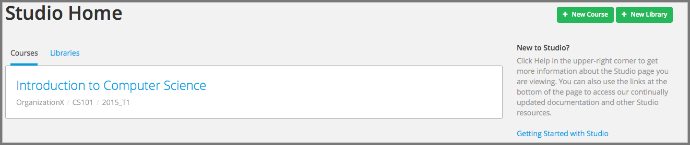
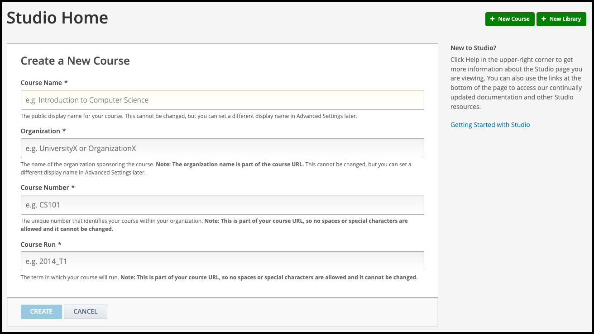
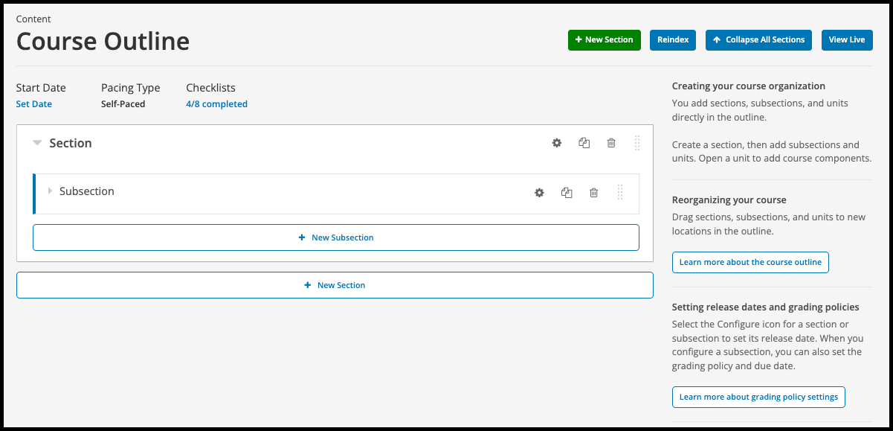

Open edX Studio is the authoring environment where educators and course teams build, structure, and manage their online courses. Follow this guide to create a new course from scratch.

## Part 1: Accessing Open edX Studio

1. **Log In to the Platform:**

   * Go to your organization's Open edX portal and log in with your instructor or staff account.

2. **Open Studio:**

   * Navigate to **Studio** (usually accessible via a link in your user profile dropdown or at `studio.yourdomain.com`).

## Part 2: Creating a New Course

1. **Start Course Creation:**

   * From the Studio dashboard, click the **"+ New Course"** button.

     

2. **Fill in Course Details:**

   * Complete the required fields in the modal window:
     * **Course Name:** The full title of your course (e.g., *Introduction to Renewable Energy*).
     * **Organization:** The institution or department offering the course (e.g., *UEG*).
     * **Course Number:** A unique code or short identifier (e.g., *RE101*).
     * **Course Run:** The session or semester identifier (e.g., *2026_Q1*).

     

3. **Save and Create:**

   * Click **"Create"**.

4. **Review Your Course Outline:**

   * Once created, the system will redirect you to the empty course outline in Studio, where you can begin structuring your curriculum, adding chapters, sequential modules, and units.

     

*Need help? If you experience any issues during registration or login, please reach out to support@abstract-technology.de.*
