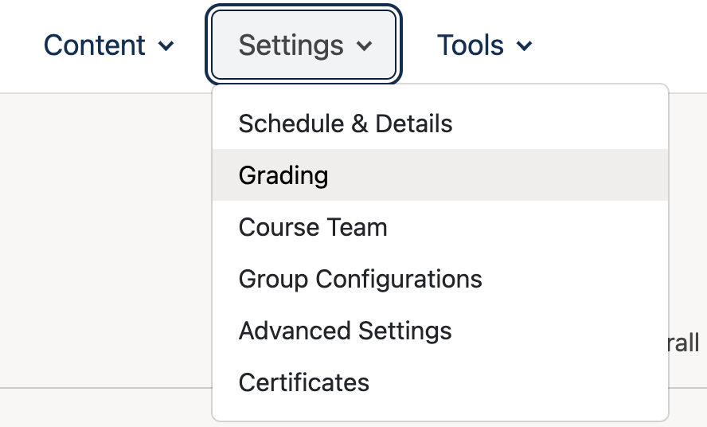
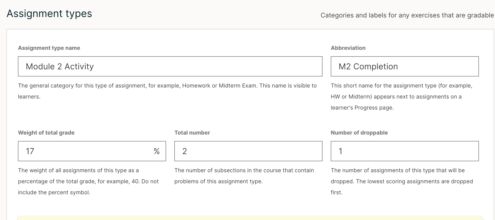
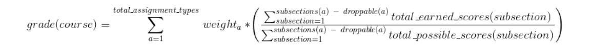
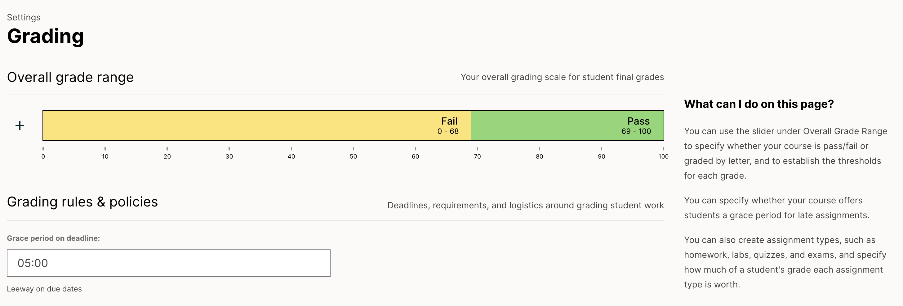
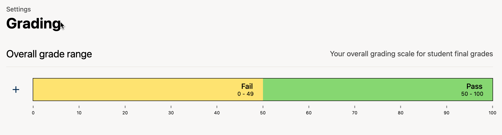
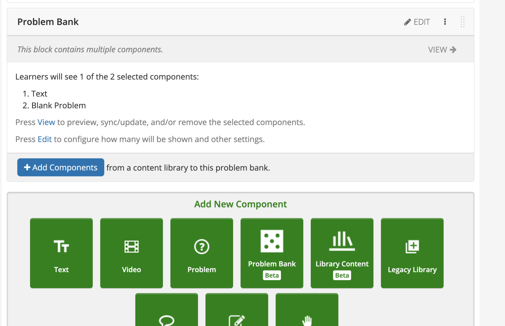
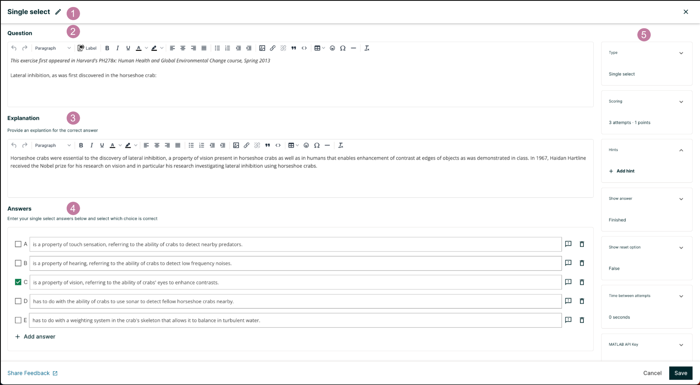
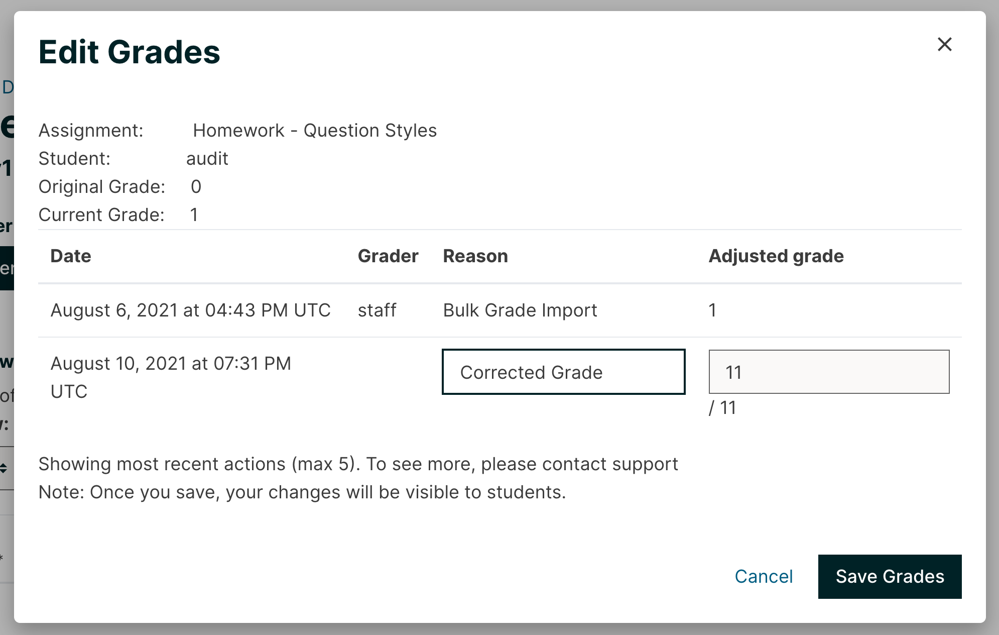

Structuring how learners are evaluated and how their final grades are calculated is essential for any structured online course. Follow this guide to set up your grading policy, assign grading weights, and create assessments in Open edX Studio.

## Part 1: Defining Your Course Grading Policy

Before creating graded assignments, you need to establish your grading categories and weight distribution.

1. **Access Course Settings:**

   * In Open edX Studio, open your course and navigate to the top navigation bar. Click on **"Settings"** and select **"Grading"**.

   

2. **Configure Assignment Types (Grading Policy):**

   * By default, the platform includes standard categories (e.g., Homework, Lab, Midterm Exam, Final Exam). You can edit these or click **"+ Add Grade Category"** to create new ones (e.g., *Quizzes*, *Participation*).

   

3. **Set Weight Percentages:**

   * Assign a percentage weight to each category (e.g., Homework: 30%, Quizzes: 20%, Final Exam: 50%). Note: The total weight across all active categories **must equal 100%**.

   

4. **Define Due Dates and Grace Periods:**

   * Set default release and due dates for assignment types, or configure how late submissions are handled.

   

5. **Set the Passing Grade:**

   * Scroll down to the **Grade Range** or **Passing Grade** section and enter the minimum percentage required to pass the course (e.g., `60`).

   

6. **Save Changes:**

   * Click the **"Save Changes"** button at the bottom of the page.

---

## Part 2: Creating Assessments (Quizzes and Problems)

Once your grading categories are set up, you can tag individual problem components to feed into those specific categories.

1. **Open a Unit:**

   * Navigate to the **Course Outline**, open a specific unit, and click on it to enter the unit editor.

2. **Add a Problem Component:**

   * In the component toolbar, click on **"Problem"** and choose a question type (e.g., *Multiple Choice*, *Checkboxes*, *Dropdown*, or *Text Response*).

   

3. **Edit the Assessment:**

   * Click **"Edit"** on the problem component to open the XML/Studio problem editor.

   * Enter your question prompt, answer choices, and specify the correct answer(s).

   

4. **Assign the Problem to a Grading Category:**

   * Click **"Settings"** (gear icon) on the problem component wrapper.

   * Under **"Problem Weight"**, enter the point value for the question.

   * Under **"Assignment Type"** (or **"Grading Category"**), select the exact grading bucket you created in Part 1 (e.g., link a quiz question to the *Quizzes* category).

5. **Save and Publish:**

   * Click **"Save"**, and then **"Publish"** the unit to make the assessment live for enrolled learners.

---

## Part 3: Managing Grading and Submissions

1. **View Learner Grades:**

   * Instructors and staff can review learner scores and override grades if necessary via the **Instructor Dashboard** under the **Student Management** or **Grading** tabs.

   

*Need help? If you experience any issues during registration or login, please reach out to support@abstract-technology.de.*
