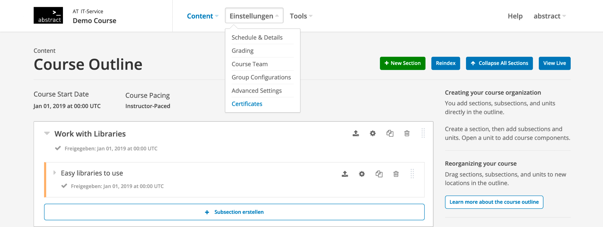
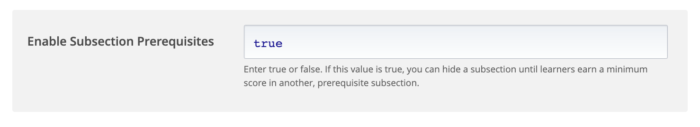
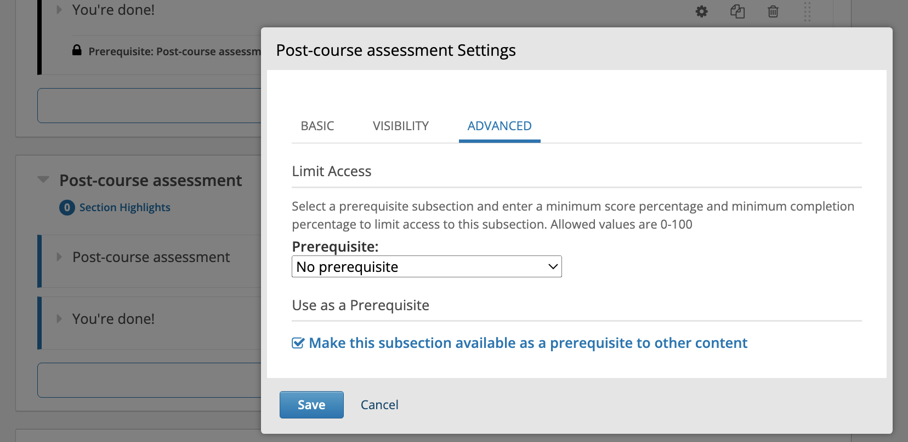
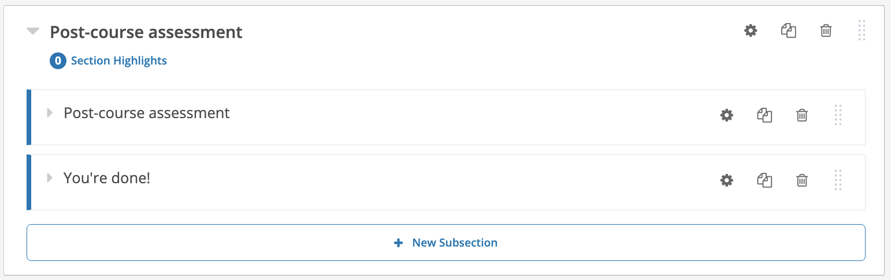
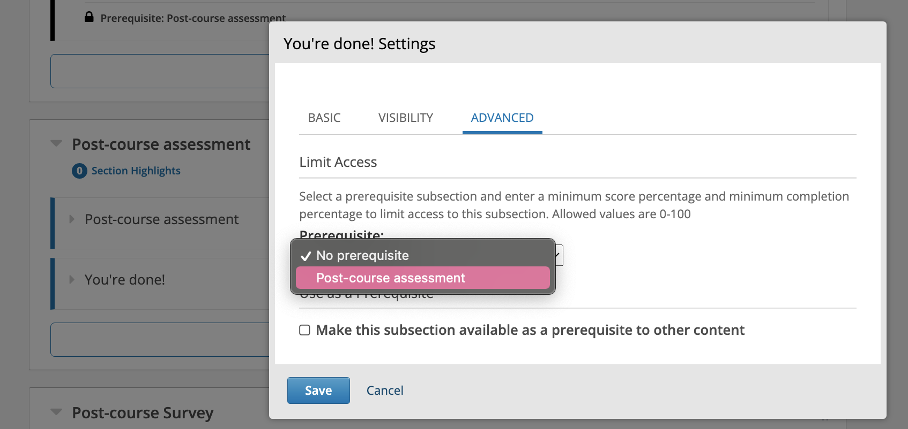
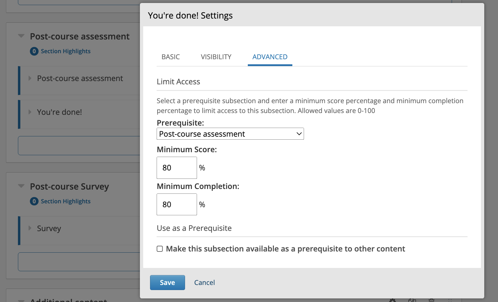
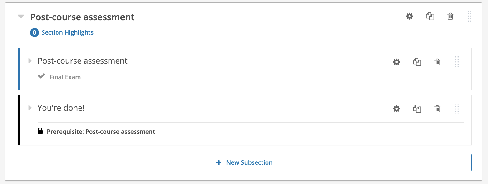

Subsection prerequisites allow you to restrict access to a specific subsection until learners achieve a minimum score or completion percentage in a designated prerequisite subsection. Follow this guide to configure and apply prerequisites in your Open edX course.

## Part 1: Enabling Subsection Prerequisites in Course Settings

Before configuring prerequisites on individual modules, you must enable the feature in your course's advanced settings.

1. **Open Your Course in Studio:**
   Log in to Open edX Studio and navigate to the course where you want to set up prerequisites.

2. **Access Advanced Settings:**
   Click on the **"Settings"** dropdown menu in the top navigation bar and select **"Advanced Settings"**.

   

3. **Enable the Feature:**
   Scroll down to find the field **Enable Subsection Prerequisites**. Type `true` into the input field.

   

4. **Save Changes:**
   Click the **"Save Changes"** button at the bottom of the page.

---

## Part 2: Configuring the Prerequisite Subsection

Next, you need to designate which subsection must be completed first.

1. **Navigate to the Course Outline:**
   Go to your course's main **Course Outline** view. Ensure you have a section containing at least two subsections (for example: *Post-course assessment* and *You're done!*).

   

2. **Open Subsection Settings:**
   Locate the subsection that learners must complete first (the prerequisite). Click its **Configure** (gear) icon.

3. **Select Advanced Options:**
   In the pop-up modal, click on the **ADVANCED** tab.

4. **Mark as a Prerequisite:**
   Check the box labeled **"Make this subsection available as a prerequisite to other content"**.

   

5. **Save:**
   Click **"Save"**.

---

## Part 3: Restricting the Dependent Subsection

Now, configure the subsequent subsection so that it remains locked until the prerequisite is satisfied.

1. **Open Settings for the Dependent Subsection:**
   In the course outline, click the **Configure** (gear) icon for the subsection you want to block (e.g., *You're done!*).

   

2. **Access Advanced Settings:**
   In the pop-up modal, select the **ADVANCED** tab.

3. **Select the Prerequisite:**
   Under **Prerequisite**, click the dropdown menu and select the name of the prerequisite subsection you configured in Part 2.

   

4. **Define Minimum Requirements:**
   Once you select the prerequisite, additional fields will appear:
   * **Minimum Score (%):** Enter the percentage of the total score learners must earn in the prerequisite subsection to unlock this content (allowed values: `0-100`). *Note: If the prerequisite is not graded, set this to `0`.*
   * **Minimum Completion (%):** Enter the percentage of the prerequisite subsection that learners must complete (allowed values: `0-100`). *Note: If you set both score and completion greater than zero, learners must satisfy both conditions.*

   

5. **Save Configuration:**
   Click **"Save"**.

6. **Verify in the Course Outline:**
   Once saved, a padlock icon and a label reading `Prerequisite: [Name]` will appear directly beneath the locked subsection in your course outline.

   

*Need help? If you experience any issues during registration or login, please reach out to support@abstract-technology.de.*

