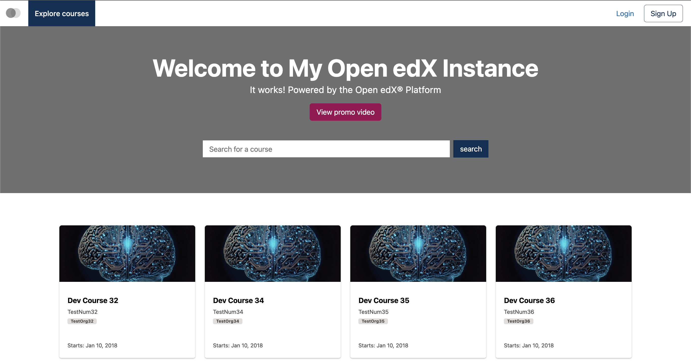
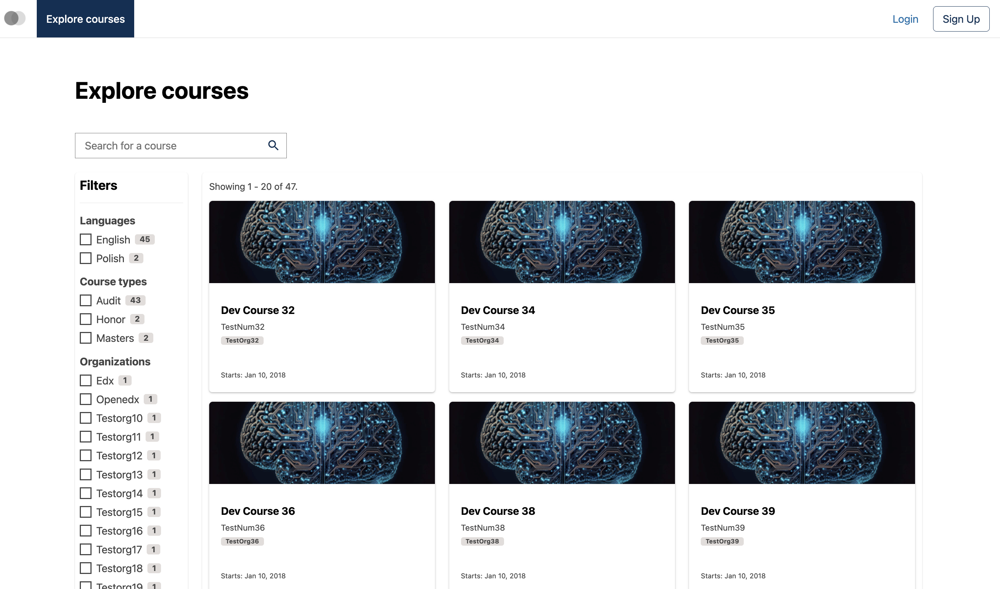
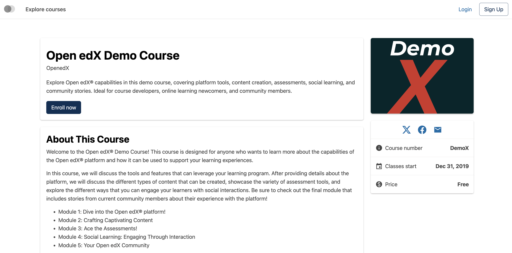
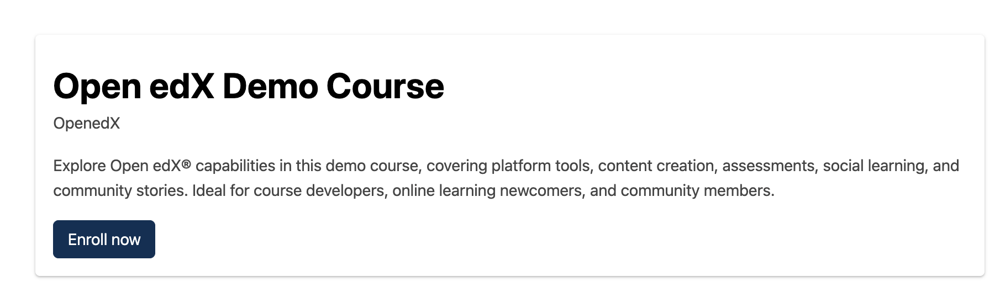
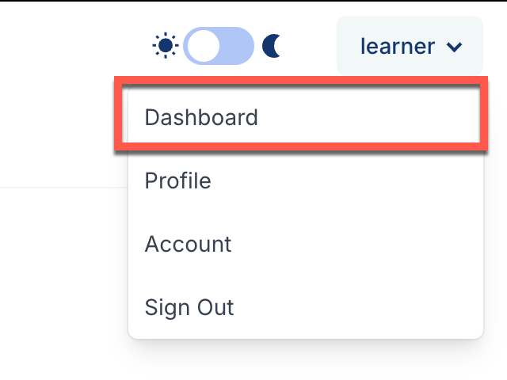
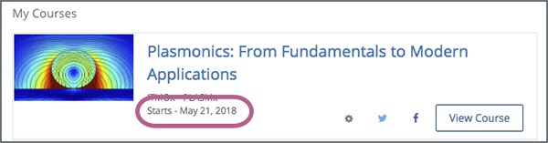
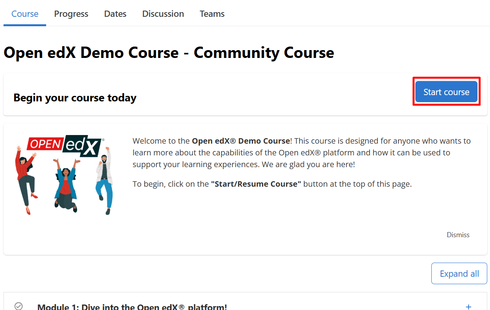

Once you are logged into your Open edX account, you can explore available courses, view detailed syllabi, and enroll with just a few clicks. Follow this guide to find and start your next learning journey.

## Part 1: Finding Courses

1. **Navigate to the Course Catalog / Explore Page:**
   * After logging in, click on **"Explore Courses"**, **"Discover"**, or **"Courses"** in the top navigation bar of the platform.

   

2. **Browse or Search:**
   * Use the **Search Bar** to type in keywords, topics, or course titles.
   * Use the **Filter Sidebar** (if available) to narrow down courses by subject, difficulty level, language, or instructor.

   

3. **View Course Details:**
   * Click on any course card that interests you to open its **About Page**. 
   * Here you can read the course overview, check prerequisites, see estimated weekly time commitments, and view what you will learn.

   

---

## Part 2: Enrolling in a Course

1. **Select Your Enrollment Option (if applicable):**
   * Depending on the platform configuration, you may see options for different enrollment tracks (e.g., Audit track for free access or Verified track for a certificate). Choose the option that fits your goals.
2. **Click Enroll:**
   * Click the **"Enroll Now"**, **"Register"**, or **"Add to Cart"** button (prominently displayed on the course overview page).

   
3. **Confirmation & Automatic Redirect:**
   * Once enrolled, you will see a confirmation message, and the system will automatically redirect you to your **Dashboard** or directly into the course home.

---

## Part 3: Accessing Your Enrolled Courses

1. **Go to Your Dashboard:**
   * Click on **"Dashboard"** in the top menu at any time to see all the courses you are currently enrolled in.

   
2. **Start Learning:**
   * Locate the course card on your dashboard and click **"View Course"** or **"Resume Course"** to open the courseware, view video lectures, complete assignments, and track your progress.

   

   

*Need help? If you experience any issues during registration or login, please reach out to support@abstract-technology.de.*
