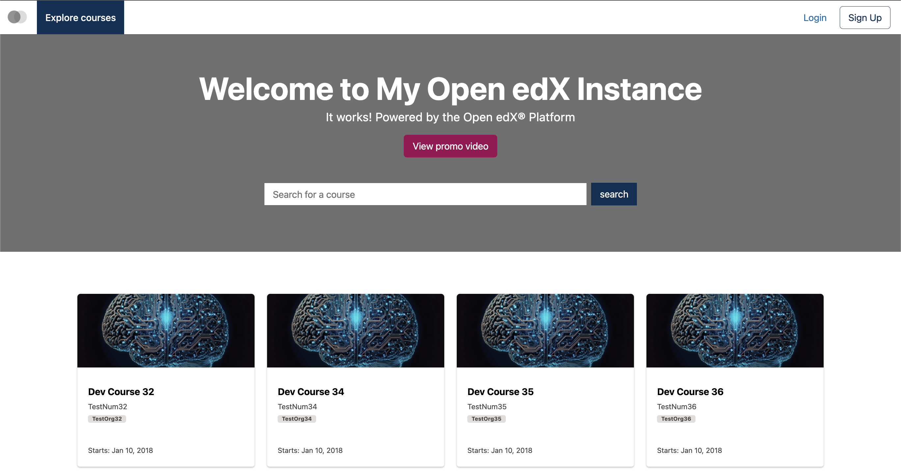
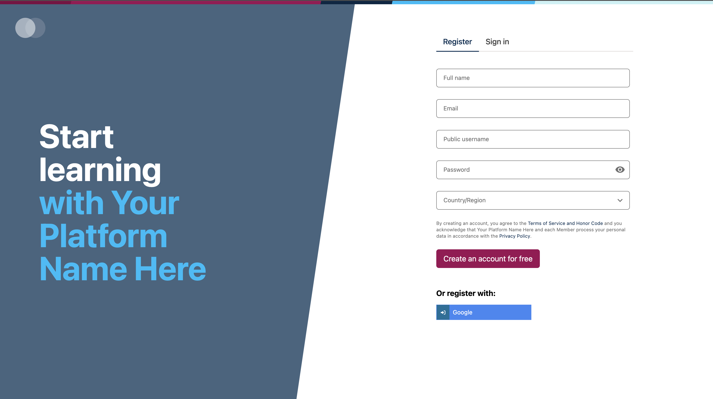
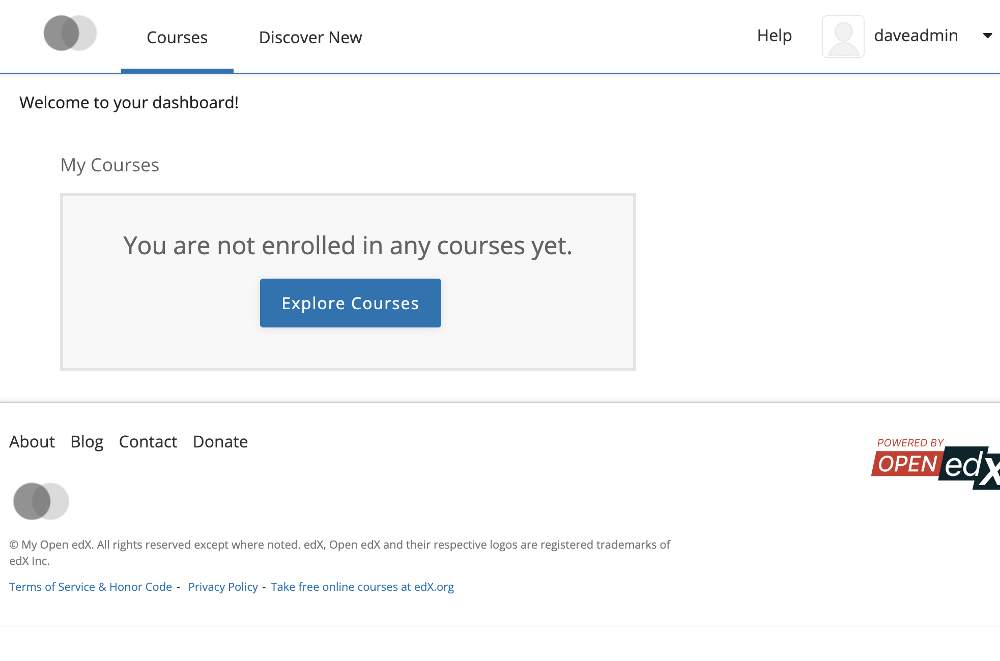
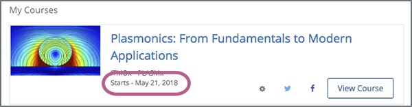

Welcome to your digital learning environment! Follow these simple steps to create your account, activate it, and log in to access your courses.

## Part 1: Creating a New Account (Registration)

1. **Navigate to the Platform:**  
   Open your web browser and go to your organization's Open edX portal URL.
2. **Access the Registration Page:**  
   Click the **"Sign Up"**, **"Register"**, or **"Create Account"** button located in the top-right corner of the homepage.

   
3. **Fill in Your Information:**  
   Complete the registration form with your required details:
   * **Full Name:** Enter your first and last name (this will appear on your completion certificates).
   * **Public Username:** Choose a unique username (note that this cannot be changed later).
   * **Email Address:** Provide a valid, frequently checked email address. *(Tip: To ensure you receive system notifications, consider adding the platform’s support or notification address to your safe senders/contacts list).*
   * **Password:** Create a secure password meeting the platform's requirements.
   * **Country/Region:** Select your location from the dropdown menu.

   
4. **Accept Terms and Conditions:**  
   Review the Terms of Service and Privacy Policy, then check the box to accept them.
5. **Complete Registration:**  
   Click **"Create Account"** or **"Register"**.

---

## Part 2: Email Activation

1. **Check Your Inbox:**  
   Open the email inbox associated with the address you just used. You should receive a confirmation message from the platform shortly.
2. **Activate Your Account:**  
   Open the email and click on the activation link provided. *(If you do not see the email within a few minutes, please check your Spam or Junk folder).*
3. **Confirmation:**  
   Clicking the link will redirect you back to the platform, confirming that your account is successfully activated.

---

## Part 3: Logging In

1. **Go to the Login Page:**  
   Click the **"Sign In"** or **"Log In"** button on the platform homepage.

   
2. **Enter Your Credentials:**  
   Input your registered **Email Address** (or Username) and your **Password**.
3. **Sign In:**  
   Click **"Sign In"** to access your learner dashboard.

---

## Part 4: Accessing Your Courses

1. **Explore Your Dashboard:**  
   Once logged in, you will land on your **Dashboard**, which displays all the courses you are currently enrolled in.

   
2. **Start Learning:**  
   Click **"View Course"** on any active course card to enter the learning interface, access materials, and begin your modules.

   

---
*Need help? If you experience any issues during registration or login, please reach out to support@abstract-technology.de.*
