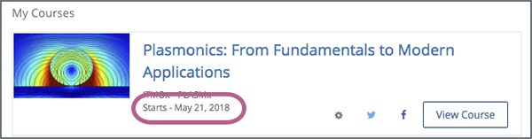
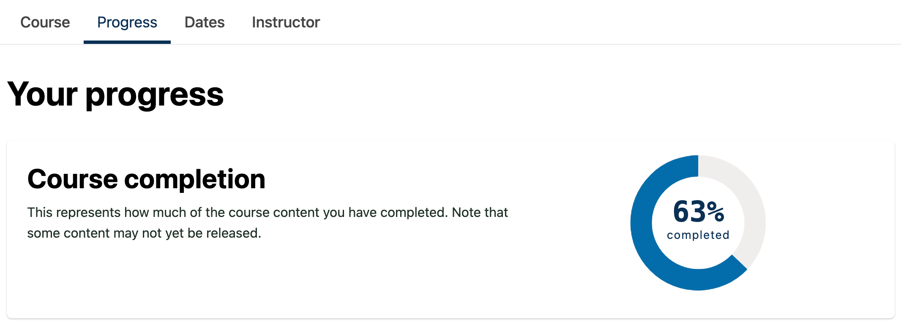
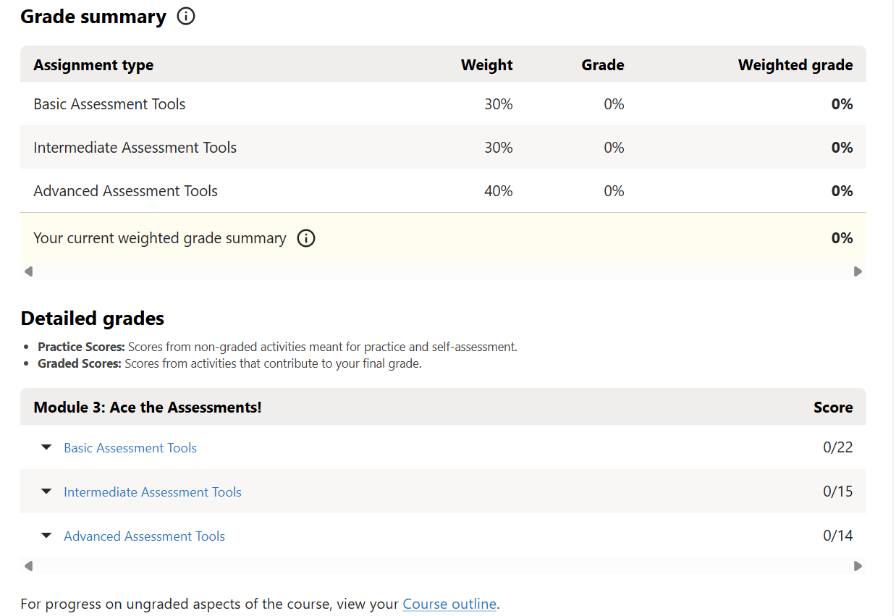
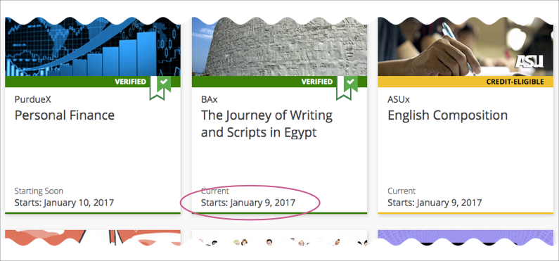
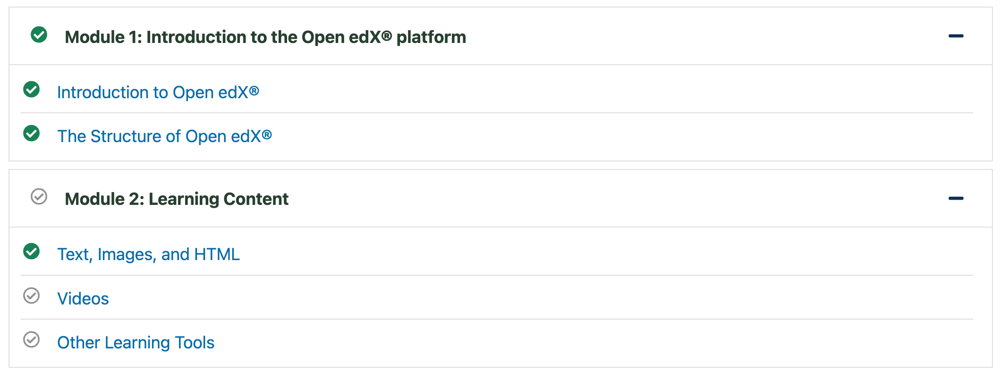
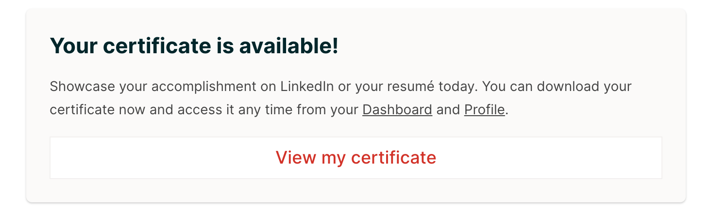

Monitoring your learning journey is key to staying on track. Open edX provides built-in tools to help you view your grades, keep track of assignment deadlines, and check your overall course completion status. Follow this guide to monitor your academic progress.

## Part 1: Viewing Your Grades and Scores

1. **Open the Course:**
   * Navigate to your **Dashboard** and click **"View Course"** on the course you want to check.

   

2. **Access the Progress Tab:**
   * In the top navigation menu of the course view, click on the **"Progress"** tab.

   

3. **Review Your Performance:**
   * Here you will see a detailed breakdown of your scores across all graded assignments, quizzes, and exams.
   * Visual charts and percentage bars show your overall standing and whether you are meeting the passing grade requirements for the course.

   

## Part 2: Keeping Track of Deadlines

1. **Check Upcoming Dates:**
   * Many Open edX courses feature a **Dates** tab in the course navigation bar. Click here to view a chronological timeline of upcoming assignment due dates, exam windows, and course milestones.
2. **Dashboard Reminders:**
   * Important upcoming deadlines are often summarized directly on your main **Dashboard** course cards so you never miss a submission.

   

## Part 3: Checking Completion Status

1. **Review Course Sections:**
   * As you complete video lectures, readings, and problem sets, green checkmarks will appear next to completed items in the course outline (left sidebar).

   
2. **Course Certificate Eligibility:**
   * If your course offers a certificate, the **Progress** page will indicate your completion status against the required passing threshold, letting you know when you have successfully satisfied all criteria.

   

*Need help? If you experience any issues during registration or login, please reach out to support@abstract-technology.de.*
